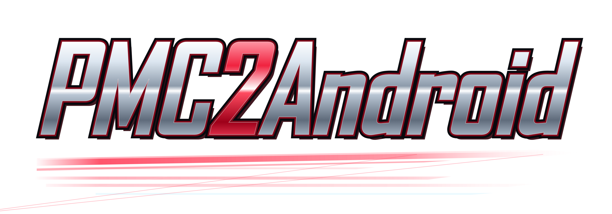
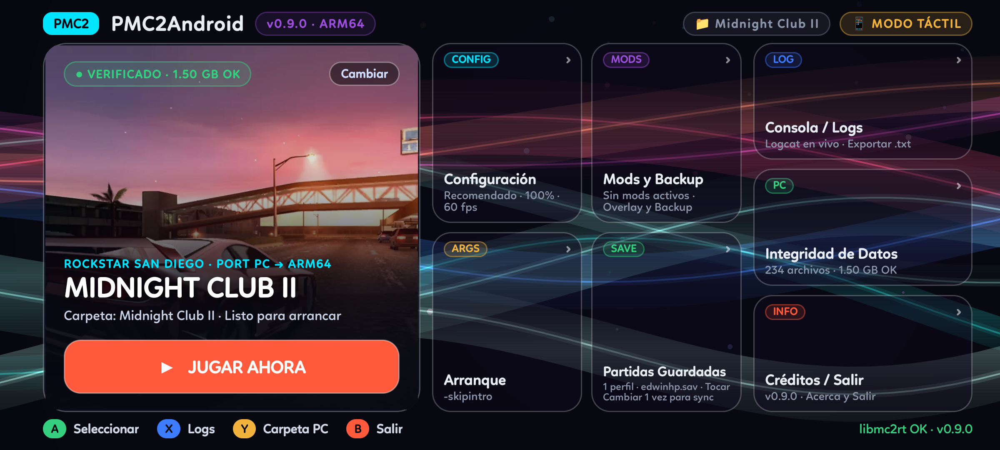
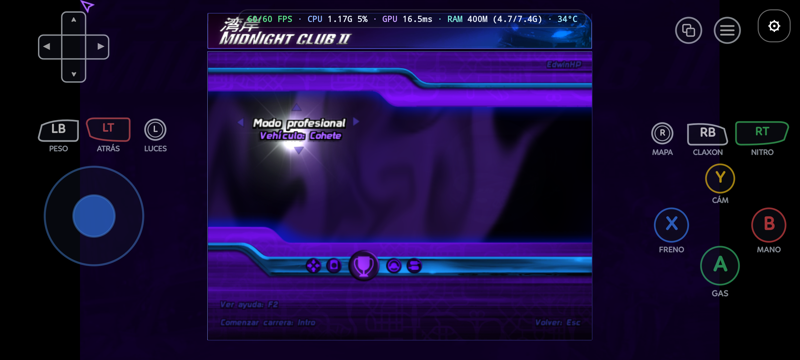

<p align="right">
  <a href="README.md">Español</a> | <b>English</b>
</p>

# PMC2Android — Midnight Club II (PC → Android ARM64)

<p align="center">
  
</p>

> **Project Status:** **Active Development (`v0.9.0` Beta)** — Playable and actively improved.

**PMC2Android** is a native port of **Midnight Club II (PC)** for Android built through **static recompilation to ARM64** rather than traditional emulation. Instead of translating x86 instructions at runtime like an emulator, all `11,226` original game functions are compiled directly into native 64-bit code running on a custom **Win32 + Direct3D 9 → OpenGL ES 3.0**, **AAudio/DirectMusic**, and **FFmpeg** bridge.

---

## Screenshots

| Launcher (`v0.9.0`) | In-Game Main Menu (`60 FPS`) |
| :---: | :---: |
|  |  |

---

## Features Beyond Vanilla Midnight Club II (PC)

In addition to running the full PC game natively on Android without an emulator, PMC2Android includes built-in visual upgrades, utilities, and patches:

### Graphics & Performance Upgrades (OpenGL ES 3.0)
* **Automatic Hardware Detection:** inspects your GPU, CPU cores, and RAM to recommend the best graphics profile (*Recommended*, *Low*, *Mid*, *High*, or *Custom*).
* **Resolution Scaling & Supersampling (`50%` – `200%`):** run below native resolution for maximum smoothness or supersample above native resolution for sharper visuals.
* **Modern Post-Processing & Quality:** selective **Bloom** for night lights and neon, **FXAA** anti-aliasing, **night contrast/sharpness** enhancement, **MSAA (`2x` / `4x`)**, anisotropic filtering (`up to 16x`), atmospheric fog, and 24-bit depth buffer.
* **Built-in Performance Overlay:** customizable HUD bar displaying live FPS, CPU usage, GPU frame time (`ms`), RAM, and temperature.

### Integrated `mc2hook` Framework (Native ARM64 Port of [jtxredline/mc2hook](https://github.com/jtxredline/mc2hook))
Configurable directly from *Settings → MC2HOOK / Online* (based on the [mc2hook](https://github.com/jtxredline/mc2hook) fork):
* **Built-in OpenSpy Support:** toggleable option to restore multiplayer connectivity after GameSpy shutdown.
* **HD Vehicle Reflections:** scalable reflection resolution (`128` up to `1024 px`), no-skip reflection updates, and car body shaders.
* **World & Traffic:** extended draw and traffic distance (`1.0x` – `2.5x`), player car models for AI racers, adjustable vehicle shadows (`50%` – `150%`), and expanded world map boundaries.
* **Physics & Classic Fixes:** 60 FPS *burnout/nitro* fix, controller fast menu scroll fix, manual transmission reverse fix, **Time Warp (`0.5x` – `1.5x`)**, and **adjustable gravity**.

### Mod Manager & Original Backup
* **Dedicated Mods Screen:** enable/disable mods (such as *ProyectR*), **reorder priority** to control override order, and import `.zip` mod packages.
* **Original Backup:** create and restore a one-tap backup of your original game files before installing mods.

### Mobile, TV & Controller Controls
* **Modern or Classic Touch Layouts** featuring a floating analog stick, adjustable opacity, and **auto-hide** when a physical gamepad (Xbox / PlayStation / generic) is connected.
* **In-Game Quick Menu (`⚙`):** toggle or tweak controls on the fly, open a virtual keyboard for profile names/cheats, and enable/disable touch mouse mode when needed.
* **Animated Launcher** with customizable visual themes and full **Android 8.0 – 16+ (Scoped Storage / SAF)** compatibility without root access.

---

## Requirements
* Android **8.0** or higher (**64-bit / `arm64-v8a`**).
* **OpenGL ES 3.0** compatible GPU.
* ~1.5 GB of free internal storage for game data.

---

## How to Install & Play

### 1. Download the App and Game Data
1. Download and install the latest **APK** from the **[Releases](../../releases/latest)** tab.
2. Download the game data archive: **[Midnight Club II (Game Data)](https://1drv.ms/u/c/096fdc474672e2fd/IQDmJIvbFwmLSrw-XqS5-O2YAVZprXXCJn5VrMr5BR761F0?e=OniMUs)**.

> [!NOTE]
> The APK does not include the game's media assets. Downloading and extracting this archive is required to play.

### 2. Extract to the Exact Path
Extract the downloaded archive (using **ZArchiver** or **RAR** on Android, or from a PC) into the root of your phone's internal storage, at this exact path:

```text
/sdcard/Midnight Club II/
```

*(In Android file managers this corresponds to `Internal Storage/Midnight Club II/`).*

Make sure the main files and folders are **directly inside** that folder (avoid nested folders like `Midnight Club II/Midnight Club II/`):

```text
/sdcard/Midnight Club II/
├── assets_p.dat
├── streams_pc.dat
├── mc2.exe
├── audio/
├── city/
├── texture_x/
├── userdata/
├── video/
└── mods/              ← optional, place your mods here (e.g. ProyectR)
```

### 3. First Launch
1. Open **PMC2Android**.
2. Tap **Select game folder** and pick the `Midnight Club II` folder in internal storage to grant access.
3. Once the integrity check shows all required files ready, tap **Play**.

### Save Files (`.sav`)
Game saves are stored in:
```text
/sdcard/Android/data/com.pmc2android.xgowther2102/files/Midnight Club II/userdata/
```
*(If you switch between a debug test build and a release APK signed with a different key, back up your `.sav` first because uninstalling deletes the private `Android/data` folder).*

---

## Version Notes & Changelog

* **`v0.9.0` (Current — Development Beta):**
  * **English & Spanish UI Support:** added language selector (`Automatic`, `Español`, `English`) in *Settings → Interface / Lang* plus a quick `🌐 EN → ES` header toggle with instant switching across launcher, settings, mods, credits, and in-game quick menu.
  * Neutralized Spanish UI wording and updated bilingual Credits dialog.
* **`v0.8.9`:**
  * Fixed automatic left/right steering pull when accelerating, boosting (nitro), or reversing on devices configured with `InputDevice: 0` (`mouse.map`).
  * Disabled touch mouse injection by default (with a `RATÓN: OFF/ON` toggle in the in-game quick menu `⚙`) to prevent stray steering/throttle touches near buttons.
* **`v0.8.x`:**
  * Native ARM64 integration of **mc2hook** with a dedicated *Settings* tab (OpenSpy, up to 1024 px reflections, 60 FPS burnout fix, manual reverse, extended traffic distance, time warp, and gravity).
  * New visual **Mods** manager with priority ordering, `.zip` import, and **Original Backup** / restore support.
* **`v0.4.x` – `v0.7.x`:**
  * Full D3D9 → OpenGL ES 3.0 renderer supporting palettized (`P8`) textures, `DXT1/3/5` compression, fog, night post-processing (Bloom/FXAA), and automatic GPU tier detection.
  * Low-latency AAudio stereo output, MP3 soundtrack streaming from `streams_pc.dat`, and `.bik` video decoding via FFmpeg.
  * Storage engine adapted to **Scoped Storage / SAF** on modern Android versions without root or restricted permissions.
* **`v0.2.0` – `v0.3.0` (Early Foundations):**
  * Transition from initial research to full PC binary recompilation (`11,226` functions on ARM64), first complete frontend boot, and initial live touch controls.

### In Progress / Known Limitations
* Still under **active development**: optional features like OpenSpy rely on active community servers, and heavier graphics settings (high MSAA + supersampling) require mid-to-high-end GPUs.

---

## Development & Source Code

If you want to build the project from source, inspect the recompiled runtime, or see how **Debug** / **Release** variants and branches are structured, check the technical guide in **[DEVELOPMENT.md](DEVELOPMENT.md)**.
