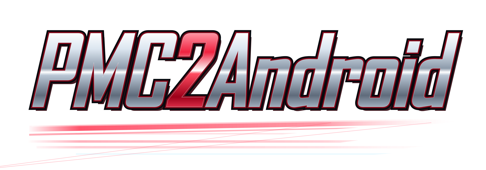
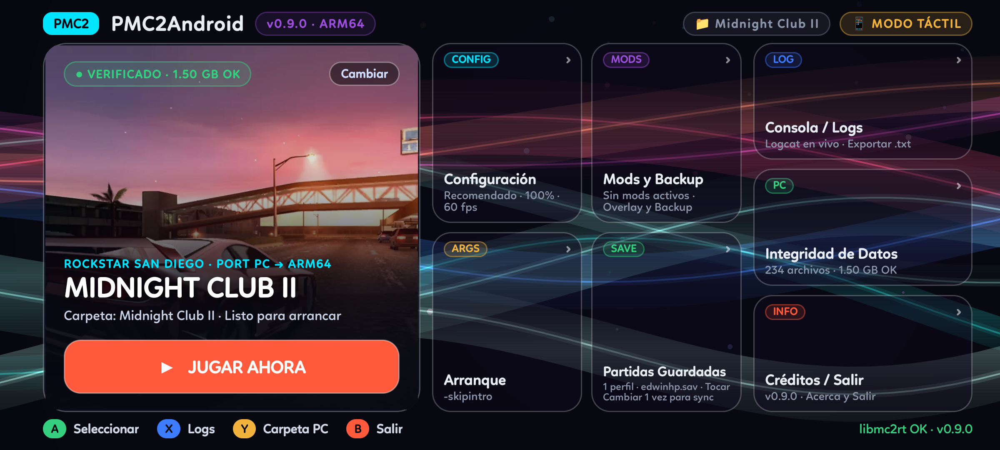
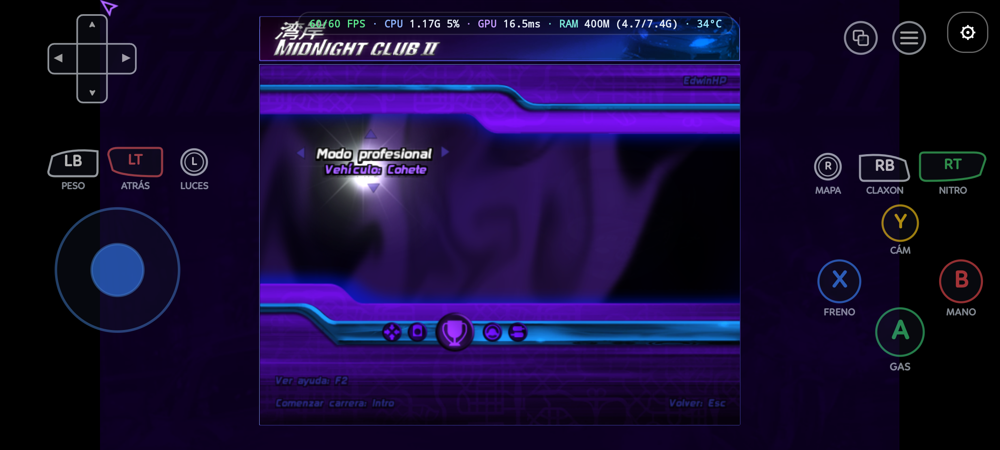

<p align="right">
  <b>Español</b> | <a href="README.en.md">English</a>
</p>

# PMC2Android — Midnight Club II (PC → Android ARM64)

<p align="center">
  
</p>

> **Estado del proyecto:** **En desarrollo activo (`v0.9.0` Beta)** — Funcional y jugable, en mejora continua.

**PMC2Android** es un port nativo de **Midnight Club II (PC)** para Android, creado mediante **recompilación estática a ARM64** en lugar de emulación tradicional. En vez de traducir instrucciones x86 en tiempo real como un emulador, las `11,226` funciones originales del juego están convertidas directamente a código nativo de 64 bits sobre un puente propio de **Win32 + Direct3D 9 → OpenGL ES 3.0**, **AAudio/DirectMusic** y **FFmpeg**.

---

## Capturas de muestra

| Launcher (`v0.9.0`) | Menú principal en juego (`60 FPS`) |
| :---: | :---: |
|  |  |

---

## Qué incluye que NO tiene el Midnight Club II vanilla de PC

Además de llevar el juego completo de PC a Android sin emulador, PMC2Android incorpora mejoras gráficas, utilidades y parches integrados:

### Mejoras gráficas y rendimiento (OpenGL ES 3.0)
* **Detección automática de hardware:** identifica tu GPU, núcleos de CPU y RAM para sugerir el perfil gráfico óptimo (*Recomendado*, *Bajo*, *Medio*, *Alto* o *Personalizado*).
* **Supersampling y escalado (`50%` – `200%`):** juega a resolución reducida para máxima fluidez o por encima de la resolución nativa para mayor nitidez.
* **Post-procesado y calidad moderna:** **Bloom selectivo** para luces/neones nocturnos, anti-aliasing **FXAA**, filtro de **nitidez/contraste nocturno**, **MSAA (`2x` / `4x`)**, filtrado anisotrópico (`hasta 16x`), niebla atmosférica y depth buffer de 24 bits.
* **Medidor de rendimiento integrado:** barra HUD configurable con FPS reales, uso de CPU, tiempo de GPU (`ms`), RAM y temperatura.

### Framework `mc2hook` integrado (adaptado nativamente a ARM64)
Opciones activables desde *Configuración → MC2HOOK / Online*:
* **Soporte OpenSpy integrado:** opción lista para volver a conectar el modo multijugador tras el cierre de GameSpy.
* **Reflejos de carrocería HD:** resolución ampliable (`128` hasta `1024 px`), actualización sin saltos de frames y shaders de carrocería.
* **Mundo y tráfico:** mayor distancia de dibujado y tráfico (`1.0x` – `2.5x`), modelos de jugador en coches de la IA, sombras de vehículo ajustables (`50%` – `150%`) y expansión de límites del mapa.
* **Física y correcciones clásicas:** fix de *burnout/nitro* a 60 FPS, fix del desplazamiento rápido en menús con mando, reversa en Transmisión Manual, **Time Warp (`0.5x` – `1.5x`)** y **gravedad ajustable**.

### Gestor de Mods y Respaldo Original
* **Pantalla exclusiva de Mods:** activa o desactiva mods (como *ProyectR*), **cambia su orden de prioridad** para decidir cuál sobrescribe primero e importa paquetes `.zip`.
* **Backup Original:** crea y restaura en un toque una copia de respaldo de los archivos originales del juego antes de probar modificaciones.

### Controles e interfaz para móvil / TV / mando
* **Controles táctiles modernos o clásicos** con joystick analógico flotante, opacidad ajustable y **auto-ocultado automático** cuando conectas un mando físico (Xbox / PlayStation / genérico).
* **Menú rápido dentro de partida (`⚙`):** ajusta controles al vuelo, abre el teclado virtual para perfiles/trucos y activa/desactiva el modo ratón táctil cuando lo necesites.
* **Launcher animado** con temas visuales personalizables y compatibilidad total con **Android 8.0 – 16+ (Scoped Storage / SAF)** sin permisos root.

---

## Requisitos
* Android **8.0** o superior (**64 bits / `arm64-v8a`**).
* GPU compatible con **OpenGL ES 3.0**.
* ~1.5 GB de almacenamiento libre para los datos del juego.

---

## Cómo instalar y jugar

### 1. Descargar la app y los datos del juego
1. Descarga e instala el **APK** desde la pestaña **[Releases](../../releases/latest)**.
2. Descarga el paquete con los datos del juego: **[Midnight Club II (Datos del juego)](https://1drv.ms/u/c/096fdc474672e2fd/IQDmJIvbFwmLSrw-XqS5-O2YAVZprXXCJn5VrMr5BR761F0?e=OniMUs)**.

> [!NOTE]
> El APK no incluye los archivos multimedia del juego. Es obligatorio descargar y descomprimir este paquete para poder jugar.

### 2. Descomprimir en la ruta exacta
Descomprime el archivo descargado (por ejemplo con **ZArchiver** o **RAR** en Android, o desde PC) en la raíz del almacenamiento interno de tu teléfono, exactamente aquí:

```text
/sdcard/Midnight Club II/
```

*(En el gestor de archivos de Android equivale a `Almacenamiento interno/Midnight Club II/`).*

Asegúrate de que **justo dentro** de esa carpeta queden los archivos y carpetas principales (evita crear carpetas duplicadas como `Midnight Club II/Midnight Club II/`):

```text
/sdcard/Midnight Club II/
├── assets_p.dat
├── streams_pc.dat
├── mc2.exe
├── audio/
├── city/
├── texture_x/
├── userdata/
├── video/
└── mods/              ← opcional, coloca aquí tus mods (ej. ProyectR)
```

### 3. Primer inicio
1. Abre **PMC2Android**.
2. Pulsa **Seleccionar carpeta del juego** y elige la carpeta `Midnight Club II` en tu almacenamiento interno para otorgarle permiso.
3. Cuando el verificador marque todos los recursos como listos, pulsa **Jugar**.

### Partidas guardadas (`.sav`)
Tus partidas se almacenan en:
```text
/sdcard/Android/data/com.pmc2android.xgowther2102/files/Midnight Club II/userdata/
```
*(Si cambias entre una build de pruebas y un Release firmado con otra clave, respalda antes tu `.sav` porque desinstalar la app borra su carpeta privada en `Android/data`).*

---

## Notas de versiones e historial del desarrollo

* **`v0.9.0` (Actual — Beta en desarrollo):**
  * **Soporte de idioma Inglés y Español:** añadido selector de idioma (`Automático`, `Español`, `English`) en *Configuración → Interfaz / Idioma* y botón rápido `🌐 ES → EN` en la cabecera de Configuración, con cambio instantáneo en launcher, configuración, mods, créditos y menú rápido.
  * Textos del launcher y diálogos unificados a tono neutral y créditos actualizados en ambos idiomas.
* **`v0.8.9`:**
  * Corregido el bug de dirección automática al acelerar, usar nitro o ir en reversa en dispositivos con `InputDevice: 0` (`mouse.map`).
  * Desactivada por defecto la inyección táctil de ratón (con botón `RATÓN: OFF/ON` en el menú rápido `⚙`) para evitar toques fantasma alrededor de los botones.
* **`v0.8.x`:**
  * Integración nativa ARM64 de **mc2hook** con pestaña dedicada en *Configuración* (OpenSpy, reflejos hasta 1024 px, burnout a 60 FPS, reversa manual, distancia de tráfico, time warp y gravedad).
  * Nuevo gestor visual de **Mods** con prioridad por orden, soporte `.zip` y sistema **Backup Original**.
* **`v0.4.x` – `v0.7.x`:**
  * Renderizado completo D3D9 → OpenGL ES 3.0 con soporte de texturas paletizadas (`P8`), compresión `DXT1/3/5`, niebla, post-procesado nocturno (Bloom/FXAA) y detector automático de GPU.
  * Audio estéreo de baja latencia vía AAudio, música MP3 desde `streams_pc.dat` y vídeo `.bik` con FFmpeg.
  * Motor de archivos adaptado a **Scoped Storage / SAF** en Android modernos (sin errores de permisos ni acceso a `/sdcard/` restringido).
* **`v0.2.0` – `v0.3.0` (Bases iniciales):**
  * Transición de pruebas iniciales a la recompilación completa de la versión PC (`11,226` funciones en ARM64), primer arranque completo del menú principal y primer renderizador táctil en vivo.

### En progreso / Limitaciones actuales
* El proyecto sigue **en desarrollo activo**: algunas funciones avanzadas como OpenSpy dependen de servidores comunitarios activos, y las opciones gráficas más pesadas (MSAA + Supersampling alto) requieren dispositivos de gama media-alta/alta.

---

## Desarrollo y código fuente

Si quieres compilar el port desde cero, revisar el motor recompilado o consultar cómo se manejan las variantes **Debug**, **Release** y las ramas del repositorio, toda la documentación técnica está en **[DEVELOPMENT.md](DEVELOPMENT.md)**.
